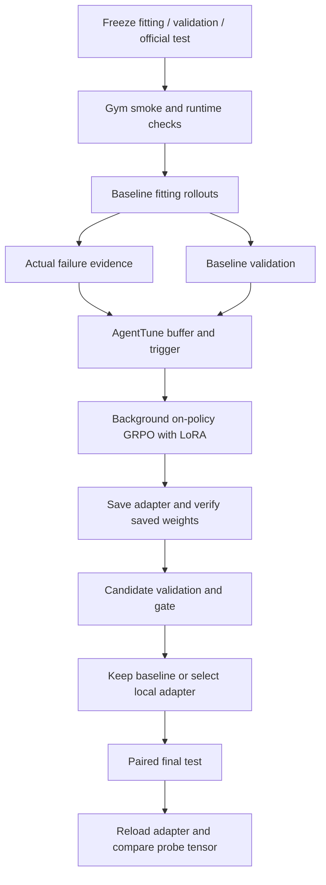

# Architecture and training flow

## Responsibilities

τ-bench supplies scenario state, policies, tools, Gym execution and task rewards.
The local Hugging Face model selects tools. TRL samples multi-turn completions
and optimizes GRPO. PEFT restricts updates to LoRA adapters. AgentTune owns the
failure buffer, retraining trigger, background training lifecycle, deployment gate
and application of its decision. This project joins those components and writes
experiment evidence to a local run directory.

## Module boundaries and execution

`cli.py` validates inputs and starts `experiment.py` with `runpy.run_module`.
`experiment.py` executes its ordered stages at module scope; importing it directly
starts the workflow and expects the internal environment variables set by the CLI.
It is not a general reusable library entry point.

`rollout.py` owns the Gym wrapper, reward callback and phase/event state.
`configure()` binds config, run directory, allowed task IDs and getters for the
current tokenizer/template. The getters let prompt checks see the active template
without copying it. `callbacks.py` records training adapter parameters at
`on_train_begin`. `config.py` is safe to import without model dependencies.

The workflow deliberately uses shared module state for the active trainer,
tokenizer, phase, allowed IDs and retraining job. The background worker performs
training followed by candidate validation; the main thread waits. This supports
one workflow per process. Starting concurrent workflows or overlapping evaluation
with training would break those assumptions. The event lock protects event writes,
not arbitrary concurrent phase changes.

## Ordered stages in `experiment.py`

| Stage | Work performed |
| --- | --- |
| 1 | Set runtime defaults, load config, create run directory and save config. |
| 2 | Freeze official-train fitting/validation partitions and official-test sample. |
| 3 | Configure the rollout bridge and shared tokenizer/template getters. |
| 4 | Run the scripted Gym smoke check; smoke-only commands stop here. |
| 5 | Check package pins, CUDA/device count, TRL interface and AgentTune origin. |
| 6 | Resolve model revision, prepare tokenizer/LoRA/GRPO settings and baseline trainer; save runtime metadata. |
| 7 | Evaluate fitting sample, identify real failures and save the initial repair dataset. |
| 8 | Serialize negative-only buffer records and baseline fitting audit. |
| 9 | Inspect baseline reward variation and evaluate fixed baseline validation. |
| 10 | Define the injected GRPO retraining callback and candidate artifact location. |
| 11 | Define candidate weight verification, validation gate and local selection callback. |
| 12 | Construct AgentTune loop, submit evidence, release baseline, tick, wait and record selection. |
| 13 | Evaluate paired official-test samples and write the final report. |
| 14 | Release training model, reload base plus adapter and compare a saved probe tensor. |

Stage definitions may create callbacks that execute later: the actual training
body defined in stage 10 runs from the background cycle started in stage 12.

## Data partitions and leakage controls

The official telecom `train` IDs are sorted and shuffled using `seed`. The leading
validation fraction is reserved; fitting uses the remainder. `fit_scan_tasks`
selects the front of fitting, `validation_tasks` selects the front of reserved
validation, and `final_test_tasks` selects the front of sorted official test.
The workflow records complete partitions and chosen samples before observing
model outcomes. It does not train from the domain's `base` split.

The recorded local smoke run had 59 fitting, 15 validation and 40 official test
IDs, with default samples of 8/4/4. Those counts depend on the installed data;
use each run's manifest as the authority.

Only failed fitting episodes become buffer evidence. The retraining callback
checks every drained trajectory against the known failure index, rejects unknown
or successful trajectories, deduplicates task IDs and rejects validation/test IDs.
Validation is used for model selection; official test is evaluated only after the
gate. Repeated manual tuning based on final-test results invalidates its role as
an untouched final test.

## Rollout API and reward

TRL creates an independent `Tau2SoloRollout` per completion. Its native tool
interface exposes public methods other than `reset` under the pinned integration.
Only `execute` is public; scoring and cleanup helpers start with `_` so the model
cannot call them as tools.

| Entry point | Contract |
| --- | --- |
| `configure(cfg, run, allowed_ids, get_tokenizer, get_template)` | Bind one experiment to the rollout module. |
| `set_phase(name, allowed_ids)` | Restrict subsequent resets to that phase's task IDs. |
| `reset(task_id, **kwargs)` | Create a fresh solo Gym environment and return ticket, policy, complete tool catalog and calling instructions. |
| `execute(tool_name, arguments_json="{}")` | Parse a JSON object, execute a Gym action and return serialized observation/termination status. |
| `_finish()` | Force `done()` if needed, read evaluated terminal reward, save the full episode once and close Gym. |
| `terminal_task_reward(completions, environments, task_id, **kwargs)` | Check completion/environment/task alignment and return actual terminal rewards. |
| `cleanup_trainer_environments(trainer)` | Finish remaining live environments; warn on cleanup failures. |

For example, a model calls the exposed wrapper with `tool_name` equal to
`get_customer_by_phone` and `arguments_json` equal to a JSON string such as
`{"phone_number":"123-456-7890"}`. It finishes with tool name `done` and arguments
`{}`. Those are wrapper inputs, not direct Python calls made by TRL users.

The initial solo Gym observation is expected to be empty. The prompt includes
public ticket/policy/tools, not evaluation criteria or reference actions. If a
tokenizer is available, reset checks full prompt tokens plus completion reserve
against the configured context. It does not silently trim policies.

Invalid argument JSON returns an error observation and consumes an action.
Reaching the action cap causes explicit finalization. Ending generation without
`done`, or hitting a TRL limit, also leads the reward callback to finalize before
reading reward. Missing evaluation, nonfinite reward or routing mismatch raises
an infrastructure error rather than substituting a zero reward.

Communication scoring is substring-based and the agent operates in solo mode,
with both customer-service and device-side tools. Always label results
**solo + substring-scored**. They are not directly interchangeable with normal
conversational/semantic-scored benchmark runs.

## GRPO and failure records

Each training row contains a generic user prompt and `task_id`. For a task, the
current policy samples a group of fresh tool-using rollouts in separate Gym
instances. Their real terminal rewards determine group-relative learning signal;
TRL performs the policy loss and configured KL regularization. Saved baseline
traces are evidence used to select tasks, not completion targets or rewards to
imitate. New rollouts are on-policy.

Failure records are AgentTune `TrainingExample` instances with
`is_negative_only=True`, `chosen=None`, trajectory ID and the actual failed action
trace/assistant messages in `rejected`. There is no fabricated successful answer.
This workflow submits those records directly, bypassing optional LLM-based
failure classification/correction services. It does not create a pretend GRPO
value in the reference DPO/BCO retraining config; its injected job calls the real
`create_agentic_trainer("grpo", backend="trl", ...)` factory.

Within-task tied rewards provide no useful group-relative reward signal. The
workflow warns when the fitting baseline exhibits no within-task variance.
That observation is a warning about the sampled baseline, not proof that all
future training groups will tie or that training succeeded.

## Closed loop and selection

The trigger threshold and minimum-ready count equal the number of prepared
failure records. All records are submitted and one `tick()` starts one retraining
cycle. The background callback rebuilds the dataset from the drained batch,
trains, saves trainer state and writes the candidate adapter.

The update audit compares trainable LoRA tensors against their actual training
initialization. It requires the same trainable parameter names, then records
whether any tensor changed. Saving checks for adapter config and nonempty weights.
Before candidate validation, saved PEFT adapter tensors must exactly match the
in-memory tensors. Candidate validation runs that matching in-memory model;
it does not independently reload a second candidate model for the gate.

The validation gate uses every fixed validation sample, including baseline
failures. It compares equal-weight means of actual per-task rewards through
AgentTune's inherited decision logic. Additional local guards require changed
LoRA weights and strict improvement (`task_new > task_old`). The configured
regression tolerance does not relax that strict-improvement guard. The guard is
on the aggregate metric; it does not enforce that every individual task improves.

If approved, the apply callback atomically replaces the run-local deployment
manifest through a staged file. If rejected, the baseline stays selected and the
candidate remains available for inspection. Both are valid completed gate
outcomes. Missing training artifacts, failed retraining or missing gate callback
are errors. No external endpoint is updated.

## Final test and reload

After selection is frozen, the original base policy is evaluated with the
candidate model's adapter disabled. The candidate is evaluated with its adapter
enabled on the same test task IDs. These reporting results do not revise the gate.
Summaries average episode rewards per task, then average those task means.
Identical seeds aid comparison but do not ensure identical sampled trajectories
once weights differ.

Finally the workflow copies a probe tensor to CPU, releases training references,
loads the recorded base revision with the saved adapter for inference and checks
that the probe tensor matches. This reload occurs after `final_report.json` is
written. Report existence alone therefore does not prove that reload succeeded;
check process exit status and the `Adapter reload verified` log message.

The implemented scope is one fresh cycle, one GPU and one process. See
[validation](../VALIDATION.md) for which portions have actually run.
